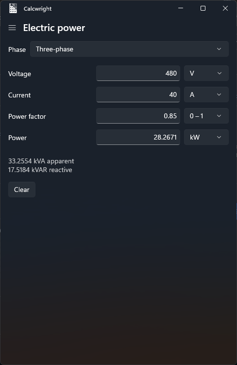
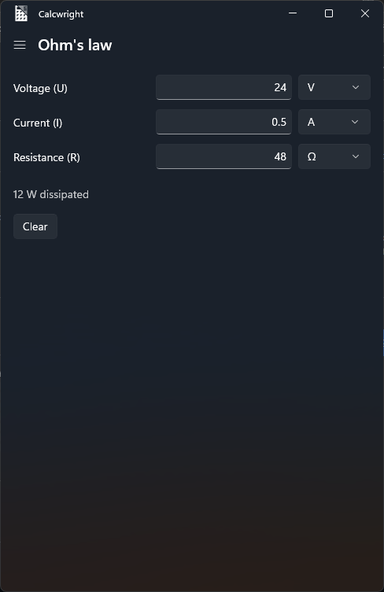
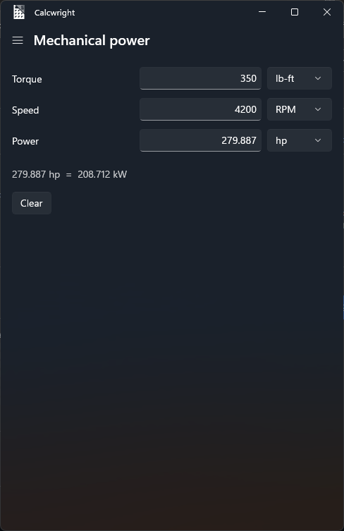
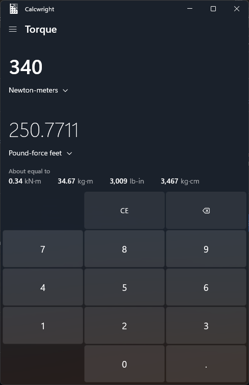
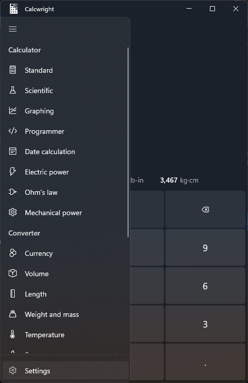

# Calcwright

**An unofficial fork of the [Windows Calculator](https://github.com/microsoft/calculator)** with extra
tools for mechanical and electrical work. Calcwright is not made, endorsed or supported by Microsoft.

It keeps everything from Windows Calculator (standard, scientific, programmer and date calculation,
history, memory and unit converters) and adds:

- **Torque converter:** newton metres, pound-force feet and inches, ounce-force inches,
  kilogram-force metres and centimetres, and more.
- **Electric power:** voltage, current, power factor and power, single-phase/DC or three-phase,
  with apparent (kVA) and reactive (kVAR) power.
- **Ohm's law:** voltage, current and resistance, plus the power dissipated.
- **Mechanical power:** torque, speed and power, with horsepower and kilowatts side by side.
- **Live currency rates** from [ExchangeRate-API](https://www.exchangerate-api.com), updated daily
  (upstream developer builds use mock data).

In the three calculators, fill in all but one field and the last one is calculated. They are listed
right after **Date calculation** in the navigation menu, and **Alt+6**, **Alt+7** and **Alt+8** open them,
continuing the stock Alt+1 to Alt+5. Torque is at the end of the converters.

Mode shortcuts also react on key-down, so pressing Alt first and letting go of it slightly before the
digit still switches modes (the stock app ignores that).

## Screenshots

| Electric power | Ohm's law | Mechanical power |
|:---:|:---:|:---:|
|  |  |  |

| Torque converter | Navigation menu |
|:---:|:---:|
|  |  |

## Getting Calcwright

**There's no public installer yet.** Calcwright is a packaged (MSIX) Windows app, and Windows only
installs those when they're signed by a publisher it trusts. A self-signed installer would ask every
user to trust the builder's own certificate, which isn't a fair thing to ask of strangers, so for now
Calcwright is available as source code.

- **Developers:** build it yourself with the steps below. Your build is signed with a certificate made
  on your own PC.
- **Everyone else:** if you'd like a ready-made installer, [open an issue](../../issues) to say so.
  Enough interest will decide whether Calcwright gets a properly signed release.

Requirements: Windows 10 (19041) or newer, x64.

## Build from source

Prerequisites:
- Windows 11 with [Developer Mode](https://learn.microsoft.com/windows/apps/get-started/enable-your-device-for-development) turned on.
- [Visual Studio 2026](https://visualstudio.microsoft.com/) (Community is fine) with the
  *Universal Windows Platform development* workload, the optional *C++ Universal Windows Platform tools*
  component, and the Windows 11 SDK (10.0.26100).

Then:

```powershell
.\Tools\build-and-run.ps1             # Debug build, installs it for the current user and starts it
.\Tools\make-installer.ps1            # signed Release build, packed as dist\Calcwright-<version>.exe
```

`build-and-run.ps1` replaces any Calcwright already installed. To share your build with people who
trust you, see [installer/README.md](installer/README.md).

Build output goes to `%TEMP%\Calcwright.Build` instead of the source tree. You can also open
`src\Calculator.slnx` in Visual Studio. For the app's architecture, see
[docs/ApplicationArchitecture.md](docs/ApplicationArchitecture.md).

## Differences from Windows Calculator

- **Graphing mode doesn't work.** Microsoft's graphing engine isn't open source, so builds from this
  repository use a mock engine (the same as upstream developer builds).
- **No diagnostic data.** Upstream sends usage data only in Microsoft's Store builds
  (`IsStoreBuild`), which this project never uses. The only network access is the daily currency-rate
  download.

## Currency rates

Rates come from ExchangeRate-API's free open endpoint (no key needed). Its terms require the
"Rates By Exchange Rate API" credit shown under the converter and don't allow redistributing the rate
data itself.

## Staying in sync with upstream

Calcwright tracks `microsoft/calculator`'s `main` branch. Upstream fixes are merged in from time to time.

## Issues and security

Please report bugs and security problems through this repository's
[Issues](../../issues), not to Microsoft. See [SECURITY.md](SECURITY.md).

## License

Licensed under the [MIT License](LICENSE).

Based on Windows Calculator, copyright (c) Microsoft Corporation, also under the MIT License.
Third-party notices are in [NOTICE.txt](NOTICE.txt). "Windows" and "Microsoft" are trademarks of
Microsoft Corporation, used here only to identify the original project.
